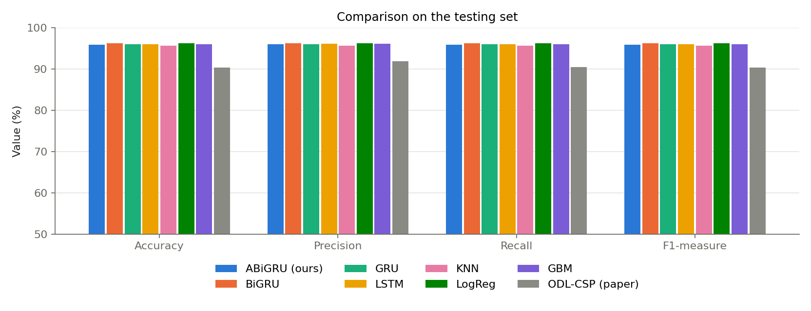
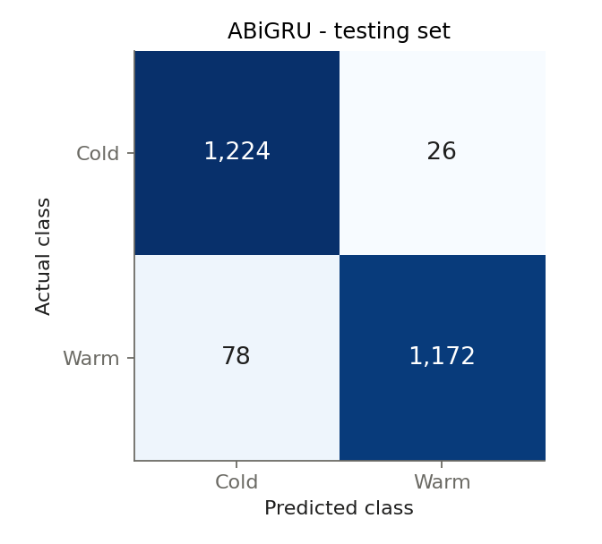
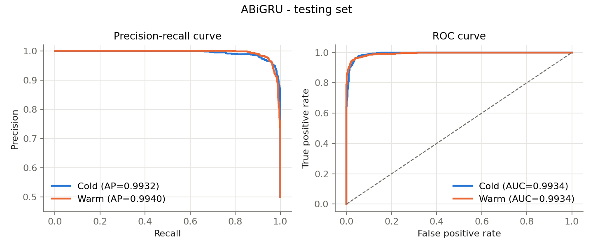
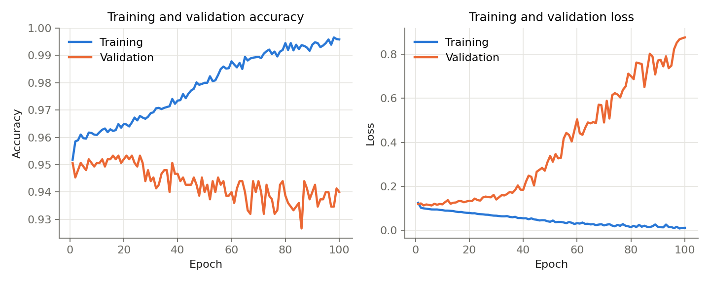
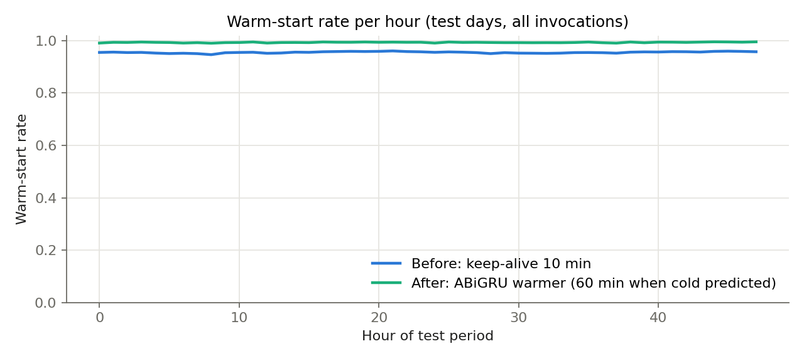

# Cold-Start Prediction & Provisioning Optimization (Azure Functions 2019)


| Paper | This implementation |
|---|---|
| Attention-based BiGRU (ABiGRU) | `coldstart/abigru.py`: BiGRU + additive attention pooling |
| RMSProp + hyperparameter tuning | `torch.optim.RMSprop`; `--tune` grid over lr x hidden |
| Predict cold start of each incoming invocation | per-invocation dataset (`coldstart/events.py`); label = cold under a 10-min keep-alive; **only past invocations are used** |
| Features: timestamp, invoke frequency, cold-start indicator, duration, previous/historical cold starts, event type, time since last cold start, consecutive cold starts | all of them, per event, over the last 16 invocations |
| Accuracy / Precision / Recall / F1 / MCC (90.36 / 91.87 / 90.42 / 90.28 / 82.28) | same metrics, on the natural test distribution **and** a balanced test subset |
| Provisioned concurrency ("function warmer") | warmer keeps the function provisioned 60 min instead of 10 when a cold start is predicted |

Baselines: BiGRU (no attention), GRU, LSTM, logistic regression, gradient boosting, "previous call was cold".

```bash
python run_paper.py --tune --epochs 5      # outputs/paper/{classification_test,warmer_test}.csv, report.json
```


## Results

1,000 random Azure functions, 10 days, seed 42. Ground-truth cold start = idle > 10 min.

### A. Paper protocol (`run_paper_protocol.py`)
Reconstructed from the paper's confusion matrix ([[1242, 0], [241, 1017]] reproduces its five
numbers exactly): 10,000 balanced invocations, stratified 75/25 split (7,500 / 2,500), macro
metrics, RMSProp (lr 1e-3, hidden 64, batch 64), 100 epochs, best-validation-loss checkpoint.

| Model (test) | Accuracy | Precision | Recall | F1 | MCC |
|---|---|---|---|---|---|
| **ABiGRU (ours)** | **95.84** | **95.92** | **95.84** | **95.84** | **91.76** |
| BiGRU | 96.16 | 96.17 | 96.16 | 96.16 | 92.33 |
| GRU | 95.92 | 95.97 | 95.92 | 95.92 | 91.89 |
| LSTM | 96.00 | 96.03 | 96.00 | 96.00 | 92.03 |
| KNN | 95.56 | 95.57 | 95.56 | 95.56 | 91.13 |
| Logistic regression | 96.20 | 96.22 | 96.20 | 96.20 | 92.42 |
| Gradient boosting | 96.00 | 96.03 | 96.00 | 96.00 | 92.03 |
| ODL-CSP (paper, AWS data) | 90.36 | 91.87 | 90.42 | 90.28 | 82.28 |

ABiGRU test confusion matrix (actual Cold/Warm x predicted Cold/Warm): [[1224, 26], [78, 1172]].


 


**Overfitting:** with only 6,750 training samples, validation loss is lowest around epochs 5-15
and rises afterwards; the reported model is the best-validation checkpoint (the paper's own
validation curve is similarly unstable). Early stopping is recommended.

### B. Realistic time-split protocol (`run_paper.py --tune`)
Train days 2-7 (400k invocations), validate day 8, test days 9-10 (395k invocations, natural
4.5% cold-start rate). RMSProp grid search picked lr 1e-3, hidden 64. Positive class = cold.

| Model | Acc | Prec | Rec | F1 | MCC | AUC | Bal. Acc* | Bal. MCC* |
|---|---|---|---|---|---|---|---|---|
| **ABiGRU** | 98.47 | 85.65 | 78.84 | **82.11** | 81.38 | 99.32 | **89.10** | **79.91** |
| BiGRU | 98.48 | 90.86 | 73.30 | 81.14 | 80.86 | 99.32 | 86.46 | 75.59 |
| GRU | 98.49 | 89.74 | 74.78 | 81.58 | 81.17 | 99.32 | 87.17 | 76.72 |
| LSTM | 98.51 | 88.52 | 76.52 | 82.09 | **81.55** | 99.34 | 88.01 | 78.10 |
| Logistic regression | 98.43 | 86.34 | 77.03 | 81.42 | 80.75 | 99.26 | 88.22 | 78.42 |
| Gradient boosting | 98.50 | 87.86 | 77.09 | **82.12** | 81.53 | 99.31 | 88.30 | 78.61 |
| "previous call was cold" | 97.69 | 74.10 | 74.05 | 74.08 | 72.86 | 86.42 | 86.39 | 75.10 |

\* balanced subset of the test set (all cold + equal random warm), threshold 0.5.

**Function warmer** (provision 60 min instead of 10 when a cold start is predicted, test days):

| Policy | Cold starts | Cold-start rate | Reduction | Warm memory (GB-h) |
|---|---|---|---|---|
| Keep-alive 10 min (no warmer) | 17,652 | 4.46% | - | 1,641 |
| **ABiGRU warmer** | **5,435** | **1.37%** | **69.2%** | 2,408 |
| LSTM warmer | 5,701 | 1.44% | 67.7% | 2,378 |
| Gradient-boosting warmer | 5,663 | 1.43% | 67.9% | 2,387 |
| Keep-alive 60 min for every function | 2,389 | 0.60% | 86.5% | 2,601 |
| Oracle warmer (upper bound) | 2,389 | 0.60% | 86.5% | 2,286 |



### C. Improved model (v2): early stopping, LR schedule, daily features, 3 seeds

Changes: early stopping (patience 3), learning rate halved on plateau, and two "same time
yesterday" features (minutes to the next call after t-24h, calls in the 10 min after t-24h).

**Ablation** (ABiGRU, 100k training invocations, seed 0, time-split test):

| Config | F1 | MCC | Bal. acc | Reduction |
|---|---|---|---|---|
| seq 16 | 0.7881 | 0.7893 | 0.8415 | 61.14% |
| seq 32 | 0.7864 | 0.7882 | 0.8395 | 60.83% |
| **seq 16 + daily** | **0.7908** | **0.7915** | **0.8442** | **61.66%** |
| seq 32 + daily | 0.7879 | 0.7892 | 0.8412 | 61.25% |
| seq 64 + daily | 0.7854 | 0.7873 | 0.8387 | 60.91% |
| seq 32 + daily, 2 layers | 0.7825 | 0.7857 | 0.8349 | 60.34% |

Daily features help slightly; longer histories and a deeper model do not.

**Final run** (seq 16 + daily, 400k training invocations, seeds 0/1/2, mean ± std):

| Model | F1 | MCC | AUC | Bal. acc | Warmer reduction | Warm memory (GB-h) |
|---|---|---|---|---|---|---|
| ABiGRU v2 | 0.8241 ± 0.0003 | 0.8199 ± 0.0006 | 0.9937 | 0.8777 ± 0.0029 | 66.82 ± 0.54% | 2,383 |
| **LSTM** | **0.8290 ± 0.0025** | **0.8237 ± 0.0020** | **0.9939** | 0.8858 ± 0.0039 | 68.04 ± 0.46% | 2,403 |
| Logistic regression | 0.8233 | 0.8160 | 0.9931 | **0.8940** | **69.30%** | 2,421 |
| Gradient boosting | 0.8234 ± 0.0078 | 0.8170 ± 0.0086 | 0.9932 | 0.8881 ± 0.0011 | 68.66 ± 0.21% | 2,402 |
| "previous call was cold" | 0.7408 | 0.7286 | 0.8642 | 0.8641 | 64.98% | 2,385 |

Compared with v1 ABiGRU (single seed), v2 improves F1 (0.8211 → 0.8241) and MCC (0.8138 → 0.8199)
and is very stable across seeds, but predicts cold starts more conservatively (reduction 69.2% →
66.8%, less extra memory). Cold starts avoided per extra GB-hour of warm memory are essentially
equal for all learned models (~15.8), so the differences in reduction come from where each model's
0.5 threshold lands rather than better prediction.

`.

## Earlier exploratory pipeline (`run_pipeline.py`): minute-level forecasting

Result (test days, thresholds picked on validation within the 10-min keep-alive memory budget):
LSTM cuts the cold-start rate from 4.46% to 0.60%, gradient boosting to 0.49%, and the
hybrid-histogram policy to 0.52% (`docs/results/minute_level_summary.csv`,
`docs/figures/minute_level_tradeoff.png`).

## Finalized idea

1. **Prediction (deep learning).** For every function *f* and minute *t*, predict
   `P(f is invoked at minute t | history up to t-1)` with an LSTM.
   - Sequence input (last 60 min): `log1p(invocations)`, sin/cos time-of-day.
   - Static input: minutes since last invocation, invocations at the same time yesterday,
     24 h and 60 min activity fraction, trigger type (http/timer/queue/...).
2. **Provisioning optimization.** Turn the predictions into a keep-warm decision per minute:
   keep a container warm when `p >= threshold` (plus 1 minute after use). The threshold is
   **chosen on the validation day** to minimize cold starts subject to a memory budget equal to
   Azure's default fixed 10-minute keep-alive.
3. **Evaluation (minute-level simulator).**
   - Cold start = invoked in a minute with no warm container.
   - Cost = warm-but-idle minutes x app memory (MB), reported as GB-hours.
   - Baselines: fixed keep-alive (1/5/10/20/60 min), hybrid histogram (Shahrad et al., ATC'20),
     gradient-boosting predictor (classical ML vs DL), and the oracle.

## Data
`C:\Users\Durga\Downloads\azurefunctions_dataset2019_azurefunctions-dataset2019`
- 1,000 functions sampled at random from day 1 (seed 42); days 1-10 loaded.
- Day 1 = history only, days 2-7 = train, day 8 = validation (threshold selection), days 9-10 = test.
- App memory (`app_memory_percentiles d01`) weights the wasted-memory cost.

## Run
```bash
pip install torch pandas numpy scikit-learn matplotlib
python run_pipeline.py                 # full run (1000 functions)
python run_pipeline.py --functions 200 --epochs 1   # quick smoke test
```
Outputs in `outputs/`: `report.json`, `summary_test.csv`, `policies_test.csv` (all thresholds),
`tradeoff_test.png` (cold-start rate vs wasted memory), `lstm.pt`.

## Layout
- `coldstart/data.py`: trace -> (functions x minutes) matrix, cached in `cache/`
- `coldstart/features.py`: leak-free features (only minutes < t)
- `coldstart/models.py`: LSTM predictor + training loop
- `coldstart/policies.py`: keep-alive, hybrid-histogram, predictive policies + scoring
- `run_pipeline.py`: end to end
